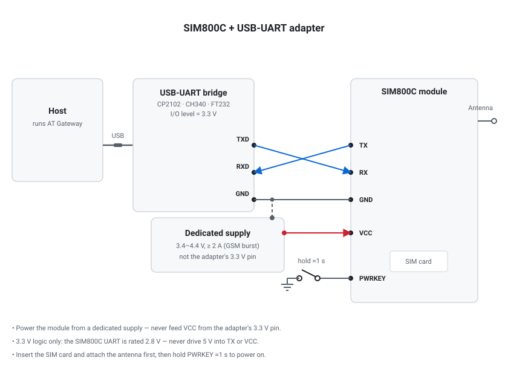
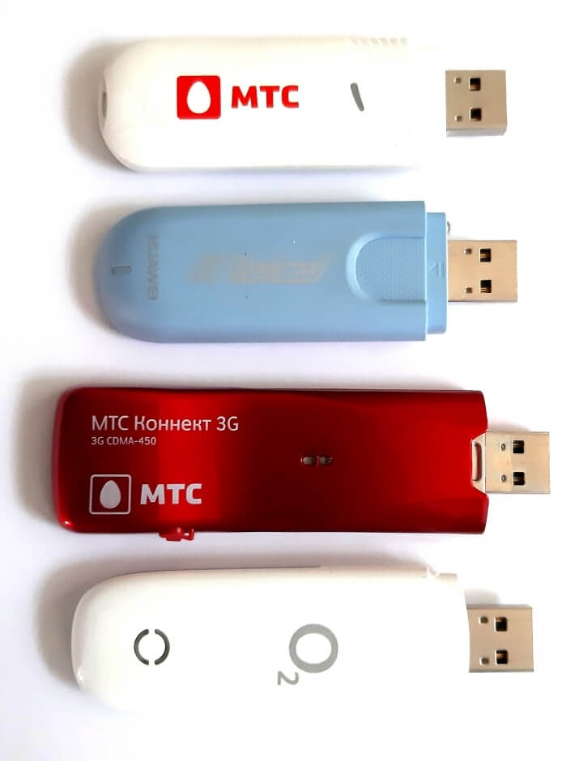
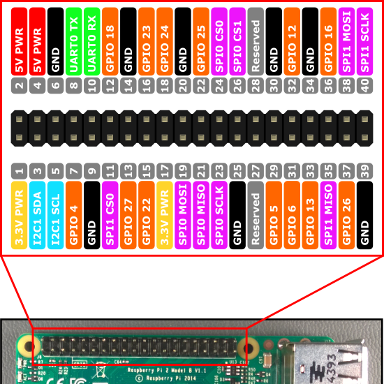
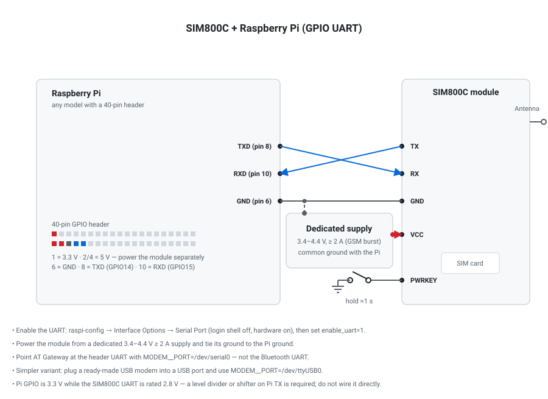
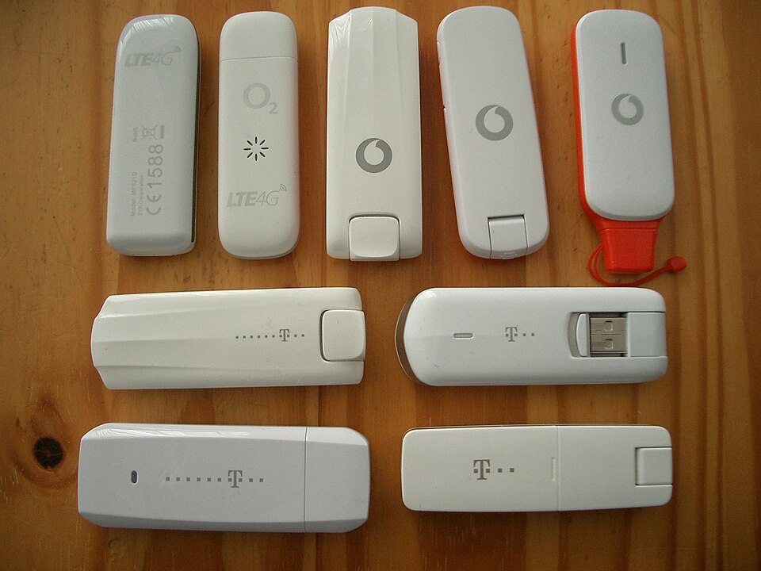

# 🔧 AT Gateway Hardware & Example Setups

Every setup below runs the same software — AT Gateway on a host with any serial AT-command modem — and differs only in how the modem reaches the host. All of them end at two settings: `MODEM__PORT` (the serial device) and `MODEM__BAUD_RATE` (default `115200`). On boot the gateway runs its init sequence (`AT`, `ATE0`, `AT+CMEE=1`, `AT+CMGF=0`, `AT+CNMI=2,1,0,1,0`) and gates on `AT+CPIN?` reporting READY, so a mis-wired modem shows up as a failing startup rather than as silent misbehaviour.

The `MODEM__PORT`/`MODEM__BAUD_RATE` blocks below are settings, not shell aliases: put them in a `.env` file in the gateway's working directory, or `export` them (or run `MODEM__PORT=... at-gateway serve`) so the gateway process actually sees them. See [Configuration](./configuration.md) for the full reference.

Common to every option: a modem that speaks standard 3GPP SMS AT commands in PDU mode, a SIM card, an antenna, and a power budget that survives GSM transmission bursts (~2 A).

## 🧩 Handmade SIM800C + USB-UART bridge

The cheapest path: a bare SIM800C board wired to any 3.3 V USB-UART adapter. Best for a bench build or when you already have the module.

<figure markdown>
  { width="640" align=center }
</figure>

### What you need

| Part                   | Notes                                                       |
| ---------------------- | ----------------------------------------------------------- |
| SIM800C breakout board | With SIM holder and antenna connector                       |
| USB-UART adapter       | CP2102 / CH340 / FT232 — **3.3 V logic**                    |
| Power supply           | 3.4–4.4 V, ≥ 2 A — do not power the module from the adapter |
| Antenna + SIM card     | Install both before first power-on                          |

### Wiring

| USB-UART adapter | SIM800C                                    |
| ---------------- | ------------------------------------------ |
| TXD              | RX                                         |
| RXD              | TX                                         |
| GND              | GND (common with dedicated supply `−`)     |
| —                | VCC ← dedicated supply `+`                 |
| —                | PWRKEY → GND (momentary button, hold ≈1 s) |

### Configuration

```bash
MODEM__PORT=/dev/ttyUSB0        # /dev/cu.usbserial-* on macOS
MODEM__BAUD_RATE=115200
```

Find the device name with `ls /dev/ttyUSB* /dev/ttyACM*` (Linux) or `ls /dev/cu.*` (macOS).

### Watch out

- The SIM800C UART is rated 2.8 V: 5 V logic can damage it, and a raw 3.3 V adapter TX line exceeds spec. Use a breakout with built-in level shifting (check the board's documentation — many SIM800C boards shift only the Pi/UART RX line), or drop the adapter's TX → module RX line with the SIMCom-recommended divider. The module's TX → adapter RX direction is fine — its output swings below 3.3 V.
- A weak supply resets the modem on GSM bursts — feed VCC from a dedicated supply, never from the adapter's 3.3 V pin.
- No SIM or a wrong PIN → `AT+CPIN?` never reports READY → the gateway never becomes ready. A missing antenna shows up later instead: registration does not complete and sends go out but never arrive. Check `AT+CREG?`'s second field — `1` (home network) or `5` (roaming) means registered; do not compare the whole response with `1,1`.

## 🔌 Ready-made USB modems

Zero-wiring option: a GSM/UMTS USB stick that exposes an AT serial interface — plug it in and point the gateway at it.

<figure markdown>
  { width="260" align=center }
</figure>

**What to look for**: a dongle that enumerates as `/dev/ttyUSB*` (or `/dev/ttyACM*`) and answers SMS commands (`AT+CMGF?`, `AT+CMGL=?`). 2G sticks of the SIM800/SIM900 class and many 3G sticks work as-is.

**Pick the right port** — sticks usually enumerate several ports (modem, diagnostics, virtual storage). Probe each one in a terminal and look for `OK`:

```bash
picocom -b 115200 /dev/ttyUSB0   # type: AT
```

### Configuration

```bash
MODEM__PORT=/dev/ttyUSB0
MODEM__BAUD_RATE=115200
```

### Watch out

- Host runs need serial permissions: `sudo usermod -aG dialout $USER`, then re-login.
- Enumeration order can change across reboots. Give the modem a stable name with a udev rule — the ids come from `lsusb`:

  ```bash
  # /etc/udev/rules.d/99-sms-modem.rules
  # Vendor/product ids live on the USB-device parent and the interface number
  # on the USB-interface parent — a rule's ATTRS matches must all hit the same
  # parent, so import the usb_id properties first and match on those instead.
  # Find the values with `udevadm info -a -n /dev/ttyUSB2`; when several
  # identical dongles share the host and yours exposes a serial number, add
  # ENV{ID_SERIAL_SHORT}=="..." as well.
  SUBSYSTEM=="tty", IMPORT{builtin}="usb_id"
  SUBSYSTEM=="tty", ENV{ID_VENDOR_ID}=="xxxx", ENV{ID_MODEL_ID}=="yyyy", ENV{ID_USB_INTERFACE_NUM}=="zz", SYMLINK+="sms-modem"
  ```

  ```bash
  sudo udevadm control --reload-rules && sudo udevadm trigger
  ```

  then set `MODEM__PORT=/dev/sms-modem`.

## 🥧 SIM800C + Raspberry Pi

An SBC as a dedicated always-on gateway. Two ways in: the GPIO UART (below) or plugging any USB modem from the previous section into a USB port.

<figure markdown>
  { width="400" align=center }
</figure>

<figure markdown>
  { width="640" align=center }
</figure>

### Wiring (physical pin numbers)

| SIM800C | Raspberry Pi                                                    |
| ------- | --------------------------------------------------------------- |
| TX      | pin 10 — RXD (GPIO15)                                           |
| RX      | pin 8 — TXD (GPIO14), via a level divider or shifter (required) |
| GND     | pin 6 — GND                                                     |
| VCC     | dedicated 3.4–4.4 V ≥ 2 A supply, ground tied to the Pi         |

Power-on: a breakout without automatic power-on needs a PWRKEY → GND pulse after power is applied — a momentary button held for ≈1 s, exactly as in the USB-UART wiring above. Boards that power on automatically skip this step.

### Enable the header UART

1. `sudo raspi-config` → Interface Options → Serial Port → login shell over serial: **No**, serial port hardware: **Yes**
2. Make sure `enable_uart=1` is set in `/boot/firmware/config.txt` (`/boot/config.txt` on older Raspberry Pi OS releases). On a Pi 5, unplug any cable from the three-pin debug UART header (`UART`) — with a cable attached, `enable_uart=1` leaves `/dev/serial0` on the debug header instead of GPIO 14 and 15
3. Reboot

### Configuration

```bash
MODEM__PORT=/dev/serial0         # the header UART, not the Bluetooth UART
MODEM__BAUD_RATE=115200
```

**USB variant**: a modem from the previous section plugged into the Pi needs no UART setup — use `MODEM__PORT=/dev/ttyUSB0`.

### Watch out

- The Pi header is 3.3 V logic while the SIM800C UART is rated 2.8 V — a level divider or level shifter on the Pi's TX line is required; do not wire it directly.
- Draw the ~2 A GSM burst from the modem's own supply, not from the Pi's power pins — sagging rails reset the modem or the board.

## 📡 4G/LTE USB dongles

SIM800-class modules are 2G-only; where 2G is switched off (or only LTE is reachable), use a Cat-1/Cat-4 module with an AT serial interface — Quectel EC25/EC200U, SIM7600 and similar.

<figure markdown>
  { width="400" align=center }
</figure>

These modules implement the same SMS AT commands (`AT+CMGF`, `AT+CMGL`, `AT+CMGR`, `AT+CMGD`) in PDU mode, so the gateway needs no changes — only the port:

```bash
MODEM__PORT=/dev/ttyUSB2         # AT port differs per model — probe for AT
MODEM__BAUD_RATE=115200
```

### Watch out

- LTE sticks expose several USB functions (AT, network, GNSS, diagnostics), each on its own tty, and the mapping differs by model and driver. Probe each `/dev/ttyUSB*` for `AT` → `OK` before configuring.
- Confirm your module's AT manual documents the SMS commands in PDU mode — not every stick does.

## 🐳 Any Linux host with Docker

Old laptop, mini PC or NAS: anything that runs Docker can run the gateway. The only hard requirement is USB passthrough of the modem.

```bash
mkdir -p /path/to/at-gateway-data
chown 1000:1000 /path/to/at-gateway-data
docker run -d --name at-gateway \
  --device /dev/ttyUSB0 \
  --group-add "$(stat -c '%g' /dev/ttyUSB0)" \
  -v /path/to/at-gateway-data:/app/data \
  -e MODEM__PORT=/dev/ttyUSB0 \
  -e HTTP__ADDRESS=0.0.0.0:3000 \
  -e AUTH__BASIC__PASSWORD=change-me-to-a-strong-password \
  -p 127.0.0.1:3000:3000 \
  ghcr.io/android-sms-gateway/at-gateway:latest
```

- Replace `AUTH__BASIC__PASSWORD` with your own strong value — the default Basic-auth user is `sms`. `-p 127.0.0.1:3000:3000` keeps the API on localhost; publish `0.0.0.0:3000` only when you intentionally want other hosts to reach it, ideally behind a reverse proxy or firewall.
- `--device` passes the modem into the container. `--group-add` grants the container user (uid 1000) access to a device node that is typically owned by `root:dialout` with mode `660`.
- `/app/data` must exist with uid 1000 ownership before the first start and be persisted — see [Installation](./installation.md) for the full notes.
- Probe the device with `AT` first (see above). For a stable name across reboots, use the host udev symlink in all three places: the device passthrough (`--device /dev/sms-modem:/dev/sms-modem`), the group lookup (`--group-add "$(stat -Lc '%g' /dev/sms-modem)"` — `-L` reads the target node's group, not the symlink's), and the gateway port (`-e MODEM__PORT=/dev/sms-modem`). A host symlink alone does not exist inside the container.

## 📄 Image credits

| File                                                          | Source                                                                                                                                             | Author        | License                                                        |
| ------------------------------------------------------------- | -------------------------------------------------------------------------------------------------------------------------------------------------- | ------------- | -------------------------------------------------------------- |
| [usb-modems.jpg](../assets/at-gateway/usb-modems.jpg)         | [Wikimedia Commons — USB broadband modems.jpg](https://commons.wikimedia.org/wiki/File:USB_broadband_modems.jpg)                                   | User:Dr.KBAHT | [CC BY-SA 4.0](https://creativecommons.org/licenses/by-sa/4.0) |
| [lte-usb-sticks.jpg](../assets/at-gateway/lte-usb-sticks.jpg) | [Wikimedia Commons — Lte-usb-sticks-de.jpg](https://commons.wikimedia.org/wiki/File:Lte-usb-sticks-de.jpg)                                         | Tschäfer      | [CC0 1.0](http://creativecommons.org/publicdomain/zero/1.0/)   |
| [pi-gpio-pinout.png](../assets/at-gateway/pi-gpio-pinout.png) | [Wikimedia Commons — Cjam-raspberry-pi-2-model-b-gpio-pins.png](https://commons.wikimedia.org/wiki/File:Cjam-raspberry-pi-2-model-b-gpio-pins.png) | Andy Oakley   | [CC0 1.0](http://creativecommons.org/publicdomain/zero/1.0/)   |

The wiring schematics [`sim800c-usb-uart.svg`](../assets/at-gateway/sim800c-usb-uart.svg) and [`sim800c-raspberry-pi.svg`](../assets/at-gateway/sim800c-raspberry-pi.svg) were created for the AT Gateway project and are covered by its Apache-2.0 license. The full credit list is also in [`ATTRIBUTION.txt`](../assets/at-gateway/ATTRIBUTION.txt).

## 📚 See Also

- [Installation](./installation.md) — binary, Docker, and source builds.
- [Configuration](./configuration.md) — serial port and every other setting.
- [Overview](./index.md) — AT Gateway as an alternative to the Android app.
