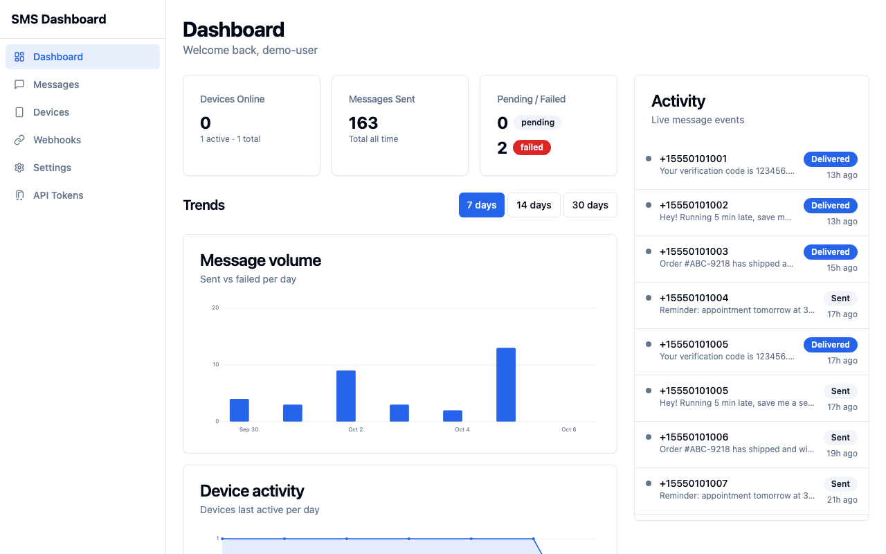

# 🚀 Getting Started

The SMS Gateway for Android™ can operate in three distinct modes, all utilizing the same API:

1. [**Local Server**](./local-server.md): Operate entirely within your local network by running the server on your Android device. This mode is perfect for quick setups with no need for Internet access. For remote access, you may need to configure your network settings and implement additional security measures.
2. [**Public Cloud Server**](./public-cloud-server.md): Easily connect via the Internet using the public server at `api.sms-gate.app`. Messages are routed through this server to your devices, simplifying the setup without requiring network adjustments. This mode is suitable for non-sensitive data only. For more secure communication, please refer to the [end-to-end encryption section](../privacy/encryption.md).
3. [**Private Server**](./private-server.md): Deploy your own server instance and connect your Android devices to ensure maximum privacy. We will not have access to your message content, making this the preferred option for sensitive communication. However, this option requires setting up and maintaining your own infrastructure, including a database and server application.

The three modes above use the **Android app** as the gateway device: install it on your phone as described in the [Installation](../installation.md) section. The app is the default gateway device in the ecosystem.

If you prefer dedicated hardware instead of a phone, [AT Gateway](../at-gateway/index.md) is an **alternative gateway device**. It runs on a serial AT modem and exposes the **same SMSGate API** from a different base URL, with modem-specific capabilities (SMS/DATA_SMS only). Clients with a configurable base URL can switch between modes transparently.

For a graphical approach, the [Web Dashboard](../services/web-dashboard.md) at `https://dashboard.sms-gate.app` provides a browser-based interface for managing messages, devices, webhooks, and settings.

<figure markdown>
  { width="800" align=center }
  <figcaption>Web Dashboard overview of gateway activity</figcaption>
</figure>

Device settings (message limits, ping intervals, working hours, etc.) can also be configured programmatically via the [Settings Management API](../features/settings-management.md), enabling automated setup across multiple devices in Cloud/Private mode, or on a single device in Local mode, without manual UI interaction.

For more details on how to use the API, please consult the [API](../integration/api.md) section.

## 📡 SMPP Server Integration

For organizations with existing SMPP-based infrastructure, the [SMPP Server](../services/smpp-server.md) provides a bridge between SMPP v3.4 clients and the SMSGate ecosystem. It operates as a separate service that translates SMPP protocol operations into REST API calls, enabling seamless integration with SMS aggregators and telecom-grade messaging platforms.

## 📧 SMTP / Email to SMS Integration

For systems that already send email, the [Email to SMS Bridge](../services/email-to-sms.md) lets you send SMS by emailing `{phone}@smtp.sms-gate.app` — no REST API integration required. Any email-capable system (monitoring tools, booking platforms, CRMs) can send SMS without code changes. See the [SMTP Integration Guide](../integration/smtp.md) for examples.

## 🤖 SMS to Telegram Integration

To receive incoming SMS in Telegram, the [Telegram Bridge](../services/telegram-bridge.md) verifies SMSGate webhooks and forwards each `sms:received` message to a chat you choose. It runs as a separate self-hosted service and requires a Telegram bot token and chat ID. See the [Telegram Bridge service page](../services/telegram-bridge.md) for setup, configuration, and deployment.

## 📟 AT Gateway: an alternative to the Android app

[AT Gateway](../at-gateway/index.md) turns a serial AT-command modem (SIM800L class, 3G/4G AT dongles) into a self-contained SMS gateway with its own HTTP API, webhooks, and metrics. No Android device, cloud account, or SMSGate server is required. It supports SMS and DATA_SMS only — MMS is not available over AT commands.

Start with the [AT Gateway overview](../at-gateway/index.md) for a device-by-device comparison, then follow its [installation](../at-gateway/installation.md) and [configuration](../at-gateway/configuration.md) guides.

## 🏗️ Building Your Own Gateway

Building your own gateway is an option that allows you to create an independent infrastructure without any connection to the public server at `api.sms-gate.app`. In most cases, this is not necessary, and you can use the [Private Server](./private-server.md) mode with all of its privacy features. However, if you require full control, please see [Custom Gateway Setup](./custom-gateway.md) section.