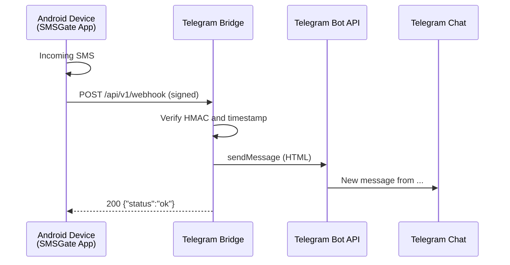

# 🤖 Telegram Bridge

The Telegram Bridge is a standalone service that receives SMSGate webhooks and forwards incoming SMS messages to a Telegram chat. Point the SMSGate webhook at this service and let it relay each `sms:received` event — no mailbox polling or custom integration code required.



## 📖 Overview

The bridge accepts the same signed webhook payloads the SMSGate app sends to any HTTP endpoint. It verifies the HMAC signature, accepts only the `sms:received` event, and sends the sender number and message text to the configured Telegram chat.

Typical uses include:

- Receiving SMS notifications in a Telegram chat, group, or channel.
- Forwarding one-time codes or alerts to a team without building a custom webhook handler.
- Keeping messages in Telegram when you do not want to poll a mailbox or write integration code.

!!! info "Self-hosted"
    SMSGate does not operate a public Telegram Bridge instance. Run the service yourself wherever it can receive SMSGate webhooks and reach the Telegram Bot API.

!!! note "Current limitations"
    - Only `sms:received` events are forwarded. Sending SMS from Telegram replies is not implemented yet.
    - The bridge forwards to a single chat (`BRIDGE__CHAT_ID`) and verifies a single signing key. To use several devices with one bridge, configure the same signing key on each device; otherwise run a separate bridge instance per key.
    - The bridge does not persist state or deduplicate retried webhooks.
    - `SMSGATE__BASE_URL`, `SMSGATE__USERNAME`, `SMSGATE__PASSWORD`, and `STORAGE__URL` are reserved for planned features and are not consumed yet.

## 🏗️ Architecture

The bridge is a standalone Go service built on Fiber and Uber Fx. It has no shared database and talks to Telegram through the Bot API. It polls Telegram for bot updates, so the Android device only needs to reach the bridge's webhook endpoint; Telegram does not need to call back into the bridge.

<div class="grid cards" markdown>

- **🔗 Webhook Ingest**
    Accepts signed SMSGate webhook deliveries at `POST /api/v1/webhook`.

- **🔒 Signature Verification**
    Authenticates every request with an HMAC-SHA256 signature and rejects timestamps outside a 5-minute window. An empty signing key is fail-closed and rejects everything.

- **✈️ Telegram Delivery**
    Sends the sender and message text to the configured chat, escaping HTML and splitting messages that exceed Telegram's length limit.

- **📊 Operations Endpoints**
    Exposes health probes, Prometheus metrics, and an optional Swagger UI for the API.

</div>

## 🚀 Getting Started

### Prerequisites

- An Android device running the SMSGate app with webhooks enabled, in Cloud, Private, or Local mode.
- A Telegram bot token from [@BotFather](https://t.me/BotFather).
- The numeric Telegram chat ID that should receive messages.
- Go 1.25+ only when building from source; Docker or a pre-built binary avoids this.

### Installation

#### Option A: Docker (recommended)

```bash title="Run Docker Container"
docker run -d --name telegram-bridge \
  -p 3000:3000 \
  -e HTTP__ADDRESS=0.0.0.0:3000 \
  -e TELEGRAM__TOKEN=123456:replace-with-token \
  -e BRIDGE__CHAT_ID=-1001234567890 \
  -e SMSGATE__WEBHOOK__SIGNING_KEY=replace-with-signing-key \
  ghcr.io/android-sms-gateway/telegram-bridge:latest
```

!!! note "Container Bind Address"
    The service defaults to `127.0.0.1:3000`, which is only reachable inside the container. Set `HTTP__ADDRESS=0.0.0.0:3000` so the published port works.

#### Option B: Pre-built Binary

Download the latest release from [GitHub Releases](https://github.com/android-sms-gateway/telegram-bridge/releases/latest):

```bash title="Download Release Binary"
curl -LO https://github.com/android-sms-gateway/telegram-bridge/releases/latest/download/telegram-bridge_Linux_x86_64.tar.gz
tar -xzf telegram-bridge_Linux_x86_64.tar.gz
./telegram-bridge
```

Linux and macOS archives use `.tar.gz`; Windows archives use `.zip`.

#### Option C: Build from Source

```bash title="Build from Source"
git clone https://github.com/android-sms-gateway/telegram-bridge.git
cd telegram-bridge
cp .env.example .env
make deps
make build
./bin/telegram-bridge
```

### Finding the Chat ID

1. Create a bot with [@BotFather](https://t.me/BotFather) and copy the token.
2. Add the bot to the target chat or group. For a channel, grant it permission to post.
3. Before starting the bridge, send a message to the bot and read the chat ID from `getUpdates`:

    ```bash title="Read Telegram Updates"
    curl -s "https://api.telegram.org/bot<TOKEN>/getUpdates"
    ```

    Find the `chat.id` value in the response. Alternatively, use a helper bot such as [@userinfobot](https://t.me/userinfobot).

4. Set `BRIDGE__CHAT_ID` to the returned value. Group and channel IDs are negative.

!!! warning "Stop the bridge before calling getUpdates"
    The bridge polls Telegram for updates. While it is running, calling `getUpdates` yourself returns a `409 Conflict`, so obtain the chat ID before the first start or stop the container temporarily.

## ⚙️ Configuration

Configuration is loaded from an optional YAML file (path in `CONFIG_PATH`), then an optional `.env` file in the working directory, then the real process environment variables. Later sources override earlier ones. Key names use `__` for nesting and are case-insensitive.

| Variable                        | Default           | Description                                                              |
| ------------------------------- | ----------------- | ------------------------------------------------------------------------ |
| **HTTP**                        |                   |                                                                          |
| `HTTP__ADDRESS`                 | `127.0.0.1:3000`  | Address the HTTP server binds to.                                        |
| `HTTP__PROXY_HEADER`            | `X-Forwarded-For` | Header used to resolve the real client IP behind a proxy.                |
| `HTTP__PROXIES`                 | `[]`              | JSON array of trusted proxy IPs.                                         |
| `HTTP__OPENAPI__ENABLED`        | `true`            | Serve the Swagger UI and API document under `/api/v1/docs`.              |
| `HTTP__OPENAPI__PUBLIC_HOST`    | *(empty)*         | Host advertised in the OpenAPI document; inferred when empty.            |
| `HTTP__OPENAPI__PUBLIC_PATH`    | *(empty)*         | Base path advertised in the OpenAPI document; inferred when empty.       |
| **Telegram**                    |                   |                                                                          |
| `TELEGRAM__TOKEN`               | *(empty)*         | Bot token from @BotFather. Required.                                     |
| `TELEGRAM__PROXY_URL`           | *(empty)*         | SOCKS5 proxy for Telegram traffic (`socks5://` or `socks5h://` only).    |
| **Bridge**                      |                   |                                                                          |
| `BRIDGE__CHAT_ID`               | `0`               | Telegram chat that receives forwarded messages. Zero means unconfigured. |
| **SMSGate**                     |                   |                                                                          |
| `SMSGATE__WEBHOOK__SIGNING_KEY` | *(empty)*         | Signing key shared with the SMSGate app. Empty rejects all webhooks.     |
| **Special**                     |                   |                                                                          |
| `CONFIG_PATH`                   | *(empty)*         | Path to an optional YAML configuration file.                             |

!!! warning "Secrets"
    `TELEGRAM__TOKEN` and `SMSGATE__WEBHOOK__SIGNING_KEY` are secrets. Keep them out of version control.

`CONFIG_PATH`, `DEBUG`, and `TZ` are read directly from the process environment, so set them in your shell rather than in `.env`.

### Example YAML Config

```yaml title="config.yaml"
http:
  address: 0.0.0.0:3000

telegram:
  token: "123456:replace-with-token"
  proxy_url: ""

bridge:
  chat_id: -1001234567890

smsgate:
  webhook:
    signing_key: "replace-with-signing-key"
```

## 🔐 Webhook Setup

Webhooks are registered through the SMSGate API. The [Web Dashboard](./web-dashboard.md) offers the same management as a web UI.

1. Register an `sms:received` webhook pointing at the bridge:

    ```sh title="Cloud mode example"
    curl -X POST -u <username>:<password> \
      -H "Content-Type: application/json" \
      -d '{ "url": "https://<your-bridge-host>/api/v1/webhook", "event": "sms:received" }' \
      https://api.sms-gate.app/3rdparty/v1/webhooks
    ```

    `<username>:<password>` are the credentials from the app's Home tab. For Local and Private mode API URLs, see [Register Your Webhook Endpoint](../features/webhooks.md#step-2-register-your-webhook-endpoint).

2. Set the device signing key in the app at **Settings → Webhooks → Signing Key** to the same value as `SMSGATE__WEBHOOK__SIGNING_KEY`.

3. Make sure the URL is reachable from the Android device that delivers the webhook: a public HTTPS endpoint for Cloud mode, or an address on the same network for Local mode.

Each delivery carries:

- `X-Signature`: hexadecimal HMAC-SHA256 of the raw request body followed by the `X-Timestamp` value.
- `X-Timestamp`: Unix time in seconds.

The bridge rejects requests whose timestamp is more than 5 minutes from its clock, and rejects every request when the signing key is empty. Delivery is at-least-once, and the bridge does not deduplicate retried webhooks, so retries can produce duplicate Telegram messages.

!!! tip "HTTPS and Private Networks"
    Use HTTPS for the webhook endpoint. On a private network, the project's [Certificate Authority](./ca.md) can issue certificates for private IP addresses. See the [Webhooks guide](../features/webhooks.md) for signature details and troubleshooting.

## 🧪 Testing the Webhook

With the bridge running locally, compute a valid signature and send a test delivery:

```bash title="Send a Signed Test Webhook"
BODY='{"event":"sms:received","payload":{"sender":"6505551212","message":"Hello from SMSGate"}}'
TIMESTAMP=$(date +%s)
SIGNATURE=$(printf '%s%s' "$BODY" "$TIMESTAMP" | openssl dgst -sha256 -hmac "change-me" | awk '{print $NF}')

curl -X POST http://127.0.0.1:3000/api/v1/webhook \
  -H "Content-Type: application/json" \
  -H "X-Signature: $SIGNATURE" \
  -H "X-Timestamp: $TIMESTAMP" \
  -d "$BODY"
```

Replace `change-me` with the same signing key configured in `SMSGATE__WEBHOOK__SIGNING_KEY`. On success the service replies with `{"status":"ok"}` after forwarding the message to Telegram.

See [`requests.http`](https://github.com/android-sms-gateway/telegram-bridge/blob/master/requests.http) in the repository for a ready-to-run example that also documents how the signature is computed.

## 📊 Monitoring

| Endpoint                                                      | Purpose                                                  |
| ------------------------------------------------------------- | -------------------------------------------------------- |
| `/health`, `/health/live`, `/health/ready`, `/health/startup` | Liveness, readiness, and startup health probes.          |
| `/metrics`                                                    | Prometheus metrics.                                      |
| `/api/v1/docs`                                                | Swagger UI; disable with `HTTP__OPENAPI__ENABLED=false`. |

| Metric                                    | Type    | Description                                  |
| ----------------------------------------- | ------- | -------------------------------------------- |
| `bridge_webhook_total{result="ok"}`       | Counter | Webhooks accepted and forwarded to Telegram. |
| `bridge_webhook_total{result="rejected"}` | Counter | Webhooks rejected by signature verification. |
| `bridge_webhook_total{result="error"}`    | Counter | Accepted webhooks that failed to forward.    |
| `bridge_webhook_forward_errors_total`     | Counter | Failed Telegram deliveries.                  |

## ❌ Error Responses

| Condition                                                     | Status |
| ------------------------------------------------------------- | ------ |
| Message forwarded successfully                                | 200    |
| Unsupported event, missing payload, or missing sender/message | 400    |
| Missing or invalid signature, stale timestamp, or empty key   | 401    |
| Telegram delivery failed or `BRIDGE__CHAT_ID` is unset        | 500    |

## 🚀 Deployment

### Docker Compose Example

```yaml title="docker-compose.yml"
services:
  telegram-bridge:
    image: ghcr.io/android-sms-gateway/telegram-bridge:latest
    ports:
      - "3000:3000"
    environment:
      - HTTP__ADDRESS=0.0.0.0:3000
      - TELEGRAM__TOKEN=${TELEGRAM__TOKEN}
      - BRIDGE__CHAT_ID=${BRIDGE__CHAT_ID}
      - SMSGATE__WEBHOOK__SIGNING_KEY=${SMSGATE__WEBHOOK__SIGNING_KEY}
    restart: unless-stopped
```

### Reverse Proxy

Expose only `/api/v1/webhook` publicly and keep `/metrics`, `/health`, and `/api/v1/docs` on the internal network. If the proxy supplies client IP headers, set `HTTP__PROXIES` and, if needed, `HTTP__PROXY_HEADER`.

## 📚 See Also

- [Webhooks Guide](../features/webhooks.md)
- [Certificate Authority](./ca.md)
- [SMSGate API Reference](../integration/api.md)
- [Email to SMS Bridge](./email-to-sms.md) — the reverse direction, sending SMS from email
- [Telegram Bridge Repository](https://github.com/android-sms-gateway/telegram-bridge)
- [Telegram Bot API](https://core.telegram.org/bots)
